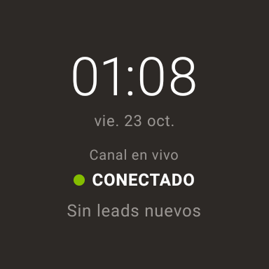
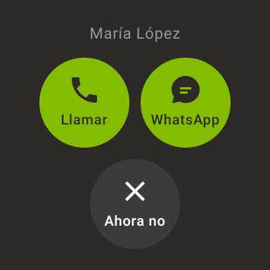
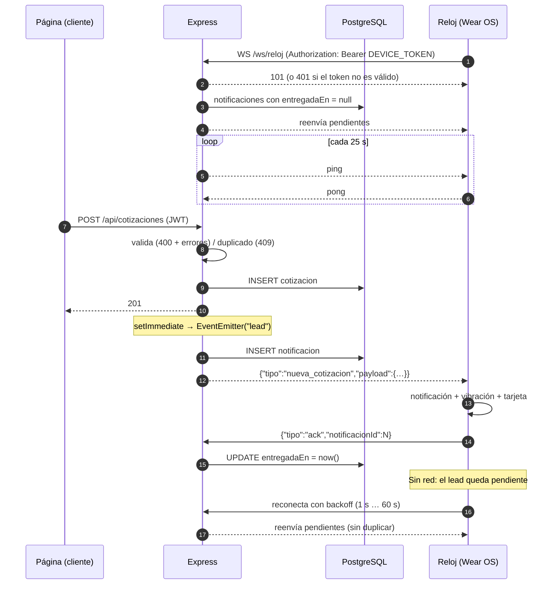

# Leads AsíDeSimple — app para smartwatch (Wear OS)

Prototipo que avisa en tiempo real al reloj cuando alguien solicita una
cotización desde la página. No hay app de teléfono: el reloj se conecta
directo al servidor Express por WebSocket.

  

## Arquitectura

```
Página (React) ──POST /api/cotizaciones──▶ Express ──guarda──▶ PostgreSQL
                                             │                 (cotizaciones,
                                   responde 201 al cliente      notificaciones)
                                             │
                                 setImmediate → EventEmitter "lead"
                                             │
                               crea Notificacion y la envía por
                               WebSocket /ws/reloj ──────────────▶ Reloj (Wear OS)
                                             ◀──── {"tipo":"ack"} ─┘
                                   guarda entregadaEn
```

**Servidor** (`server/`)

| Pieza | Archivo |
| --- | --- |
| Canal WebSocket, registro de relojes, ping cada 25 s, pendientes y ack | `realtime/reloj.js` |
| Validación (400 con `errores`), duplicados (409) y emisión | `routes/cotizaciones.js` |
| `GET /api/salud` y `POST /api/dev/notificacion-prueba` (solo ADMIN) | `index.js` |
| Modelo `Notificacion` y `Cotizacion.telefono` (opcional) | `prisma/schema.prisma` |
| SQL de referencia del cambio (aditivo) | `prisma/manual/20261020_notificaciones_reloj.sql` |
| Pruebas de integración (`npm test`) | `test/reloj.test.js` |

**Reloj** (`watch-app/app/src/main/java/ai/asidesimple/reloj/`)

| Pieza | Archivo |
| --- | --- |
| Servicio en primer plano (mantiene el socket con la pantalla apagada) | `RelojService.kt` |
| OkHttp WebSocket, reconexión con backoff 1 s → 60 s, ack | `ClienteReloj.kt` |
| Notificación local + vibración 200·100·200·100·400 ms | `Avisos.kt` |
| Historial y deduplicación por `notificacionId` | `Almacen.kt` |
| Pantallas: Reposo, Tarjeta, Acciones, Historial, Sin conexión | `ui/Pantallas.kt` |
| Llamar (`ACTION_DIAL`) y WhatsApp (`wa.me`, se abre en el teléfono emparejado) | `Acciones.kt` |

### Protocolo

Servidor → reloj:

```json
{"tipo":"nueva_cotizacion","payload":{"leadId":12,"notificacionId":34,"nombre":"María López","servicio":"Chatbot IA","telefono":"+524426150681","hora":"2026-10-23T00:45:59.686Z"}}
```

Reloj → servidor: `{"tipo":"ack","notificacionId":34}`

- `servicio` es el nombre del producto del catálogo (la cotización no tiene otro campo de servicio).
- `telefono` puede ser `null`: la página actual no lo pide (el campo existe en el API y es opcional). Sin teléfono, los botones Llamar y WhatsApp aparecen deshabilitados.
- Al conectarse, el reloj recibe todas las notificaciones con `entregadaEn = null`. El servidor no repite una notificación en el mismo socket y el reloj ignora los `notificacionId` que ya mostró, aunque de todos modos vuelve a mandar el ack.
- `nueva_compra` ya está soportado en el protocolo y en el reloj, pero el servidor todavía no tiene una ruta de compra.

## Variables de entorno

**Servidor** (Render → Environment, o `server/.env` en local):

| Variable | Uso |
| --- | --- |
| `DEVICE_TOKEN` | Token compartido con el reloj. Sin ella, `/ws/reloj` rechaza todo (401). Genera uno con `node -e "console.log(require('crypto').randomBytes(24).toString('hex'))"` |
| `DATABASE_URL`, `JWT_SECRET`, `PORT` | Las que ya existían |

**Reloj** (`watch-app/local.properties`, no versionado; ver `local.properties.example`):

| Clave | Variable equivalente en CI | Uso |
| --- | --- | --- |
| `reloj.deviceToken` | `RELOJ_DEVICE_TOKEN` | Igual al `DEVICE_TOKEN` del servidor |
| `reloj.wsUrl.prod` | `RELOJ_WS_URL` | `wss://proyecto-web-ai.onrender.com/ws/reloj` |
| `reloj.wsUrl.local` | `RELOJ_WS_URL_LOCAL` | Por defecto `ws://10.0.2.2:3001/ws/reloj` (el localhost de la PC visto desde el emulador) |

Sabores: `local` (paquete `ai.asidesimple.reloj.local`, permite `ws://`) y `prod`.

## Correr en el emulador

1. Servidor local:
   ```bash
   cd server
   DEVICE_TOKEN=<token> npm run dev        # usa DATABASE_URL de server/.env
   npx prisma db push                      # la primera vez, para crear la tabla notificaciones
   ```
2. Emulador Wear OS redondo (por ejemplo, el AVD `Wear_OS_Small_Round_Ligero`, API 30):
   ```bash
   %LOCALAPPDATA%\Android\Sdk\emulator\emulator -avd Wear_OS_Small_Round_Ligero
   ```
3. Instalar y abrir:
   ```bash
   cd watch-app
   gradlew installLocalDebug
   adb shell am start -n ai.asidesimple.reloj.local/ai.asidesimple.reloj.MainActivity
   ```
4. Ver los eventos: `adb logcat -s RelojLeads`

> Con 8 GB de RAM, cierra el emulador antes de compilar o compila primero y abre el emulador después.

## Probar con curl

```bash
# 1) Sesión de un cliente
TOKEN=$(curl -s -X POST localhost:3001/api/auth/login -H 'Content-Type: application/json' \
  -d '{"email":"cliente@ejemplo.com","password":"secreta123"}' | node -pe 'JSON.parse(require("fs").readFileSync(0)).token')

# 2) Cotización (usa un archivo UTF-8 si el nombre lleva acentos; en Windows curl manda Latin-1 desde la terminal)
curl -X POST localhost:3001/api/cotizaciones -H "Authorization: Bearer $TOKEN" \
  -H 'Content-Type: application/json' \
  -d '{"productoId":1,"modulosSeleccionados":["Agenda en Google Calendar"],"telefono":"+524426150681"}'
# → 201 y la tarjeta aparece en el reloj. Repetirla en menos de 2 min → 409.
# Datos inválidos → 400 {"error":"…","errores":["…"]}

# 3) Notificación falsa (JWT de un ADMIN)
curl -X POST localhost:3001/api/dev/notificacion-prueba -H "Authorization: Bearer $TOKEN_ADMIN" \
  -H 'Content-Type: application/json' -d '{"nombre":"Prueba"}'

# 4) Estado
curl localhost:3001/api/salud   # {"ok":true,"baseDeDatos":"ok","relojesConectados":1,...}
```

## Instalar en un Galaxy Watch 6 Classic (sin cable)

1. Descarga el APK desde GitHub → Actions → *App del reloj (APK debug)* → artifact `reloj-leads-debug-apk` (`app-prod-debug.apk`). Para que ese APK traiga URL y token, configura antes los secrets `RELOJ_WS_URL` y `RELOJ_DEVICE_TOKEN` del repositorio. O compílalo tú con `gradlew assembleProdDebug` usando tu `local.properties`.
2. En el reloj: **Ajustes → Acerca del reloj → Software → toca 5 veces "Versión de software"** para activar Opciones de desarrollador.
3. **Ajustes → Opciones de desarrollador → Depuración ADB: activar** y **Depuración inalámbrica: activar** (reloj y PC en la misma red Wi-Fi).
4. Dentro de *Depuración inalámbrica* → **Vincular nuevo dispositivo**: el reloj muestra `IP:PUERTO_VINCULACION` y un código de 6 dígitos.
   ```bash
   adb pair 192.168.1.50:37123        # pide el código de 6 dígitos
   adb connect 192.168.1.50:41234     # IP:PUERTO que aparece en la pantalla principal de Depuración inalámbrica (es otro puerto)
   adb devices                        # debe listar el reloj
   adb install -r app-prod-debug.apk
   adb shell am start -n ai.asidesimple.reloj/ai.asidesimple.reloj.MainActivity
   ```
5. Acepta el permiso de notificaciones. La notificación persistente "Canal en vivo: CONECTADO" confirma la conexión.

## Diagrama de secuencia



## Limitaciones conocidas

- Render (plan gratuito) duerme el servicio tras ~15 min sin tráfico entrante. Los pings de 25 s evitan que el proxy corte el socket por inactividad, pero **no está verificado** que Render los cuente como tráfico para no dormir. Si el servicio se duerme o se reinicia, el reloj reconecta solo y recibe los pendientes; la primera reconexión puede tardar lo que tarde Render en despertar (~1 min).
- Wear OS puede restringir la red en modo de ahorro de batería extremo. Para producción conviene sumar FCM como respaldo.
- En el emulador no hay teléfono emparejado: WhatsApp muestra un aviso en lugar de abrir el chat.
